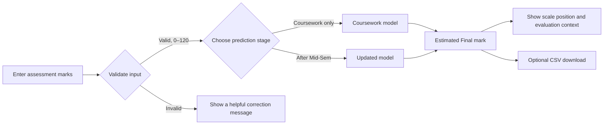
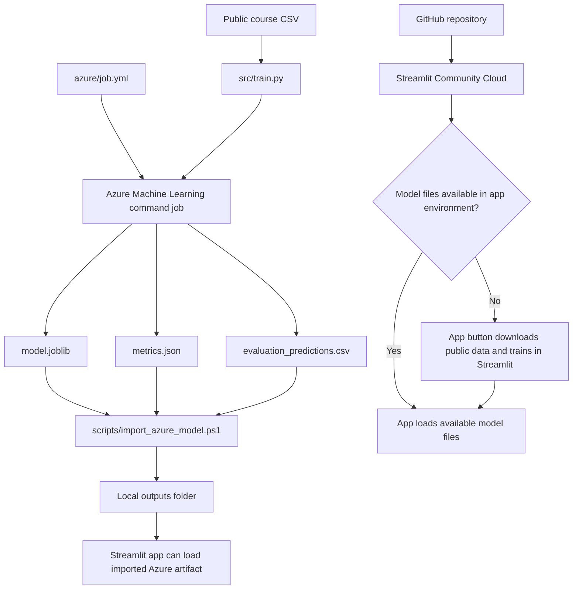

# Student Performance Prediction with Machine Learning and Azure

A small educational project that estimates a student's **course Final mark** from assessment marks already available. The project includes a Streamlit app, regression-model training and evaluation, an Azure Machine Learning command-job configuration, and a public live demo.

> **Live demo:** [Open the Engineering Grade Predictor](https://student-performance-prediction-sssdzsrk8c2eqnkbb4zceu.streamlit.app/)

This is a learning demonstration, not an official grading tool. It uses a small public dataset from one Chemical Engineering course at McMaster University. It has **one Midterm field**, labelled **Mid-Sem** in the app; it does not contain two mid-semester exams. The dataset is not evidence of accuracy for another course, college, or assessment scheme.

## What the app does

- Estimates a Final mark on the dataset's **0–120 mark scale**.
- Offers two stages, based on which assessment marks are available:

  | Stage | Inputs used |
  | --- | --- |
  | Coursework marks only | Assignment average, Tutorial average |
  | After the Mid-Sem | Assignment average, Tutorial average, Mid-Sem, and Take-home assessment |

- Provides illustrative sample marks for a quick demonstration.
- Supports one-student estimates and batch CSV estimates (up to 1,000 rows and 5 MB).
- Shows held-out evaluation results, a predicted-versus-actual plot, model comparisons, and optional local history.
- Exports individual and batch results as CSV.

The coursework-only stage may select a **mean baseline**. When that happens, its result is the training-set course average and does not change with the entered coursework marks. The app explains this when it occurs. If a Take-home mark is not available in the later stage, the model fills that input with the median from its training data.

## How a prediction works



For a group, the app validates the uploaded CSV columns and marks before making estimates. The sample CSV button provides the required headers. Names and student IDs are not needed for a single prediction; an optional `student_id` column in a batch is returned in the downloaded results but is not stored in prediction history.

## How training and hosting fit together

Azure Machine Learning is used to run the training job. Streamlit Community Cloud hosts the interactive web app. These are separate services in this project: the live app is **not** an Azure-hosted web app and does **not** call an Azure real-time endpoint.



The Azure job is the project's cloud-training evidence. It runs `src.train` on CPU compute and saves the model and evaluation files as the `model_output` job artifact. The PowerShell import script downloads a trusted job's artifact into the local `outputs/` folder so the local app can use it. Generated `outputs/` files are intentionally excluded from Git. Therefore, the deployed Streamlit app normally trains in its own environment when its model files are absent; importing the Azure artifact on a developer's computer does not automatically send it to Streamlit Cloud.

### Azure training files

| File | Purpose |
| --- | --- |
| `azure/job.yml` | Defines the Azure command job, public CSV input, training command, and `model_output` artifact. |
| `azure/compute.yml` | Describes the CPU compute cluster configuration. The workspace must have a cluster matching the job's `cpu-cluster` target. |
| `azure/conda.yml` | Lists the Python environment used for Azure training. |
| `src/train.py` | Trains both prediction stages, compares algorithms, evaluates the selected models, and saves artifacts. |
| `scripts/import_azure_model.ps1` | Downloads and checks the Azure job artifact, then activates it for the local app. |

The Azure job expects an existing Azure ML workspace and `cpu-cluster`. Compute can incur charges while active; configure the cluster to scale to zero when idle and review subscription costs.

Example submission from the project root, after signing in with Azure CLI and selecting the correct subscription:

```powershell
az extension add --name ml
az ml job create --file azure/job.yml --resource-group <resource-group> --workspace-name <workspace-name>
```

After the job completes, view it in Azure Machine Learning Studio under **Jobs**. Open the job to show **Overview** and **Outputs + logs**, then inspect `model_output` for the saved artifacts. The exact job display name depends on the submitted run. See the [Azure ML job documentation](https://learn.microsoft.com/cli/azure/ml/job) and the [command-job YAML reference](https://learn.microsoft.com/en-us/azure/machine-learning/reference-yaml-job-command?view=azureml-api-2).

## Model training and evaluation

The source dataset has 99 records; 96 have a Final mark. Training removes rows without a Final mark, then makes a fixed 80/20 train/test split. With the current data, that gives 76 training records and 20 held-out records. On the 76 training records, the code compares a mean baseline, Linear Regression, Decision Tree, and Random Forest using repeated 5-fold cross-validation (3 repeats). Preprocessing is fitted inside each cross-validation pipeline. A one-standard-error simplicity rule prefers a simpler algorithm when its score is close to the best score.

After the held-out check is recorded, the selected app model is refit on all 96 labelled records. Evaluation predictions still come from models trained only on the 76 training records; they are not predictions made by the all-record deployment model.

For the bundled data, the saved evaluation reports approximately:

| Stage | Selected model | Cross-validation MAE | Held-out MAE | Mean-baseline held-out MAE |
| --- | --- | ---: | ---: | ---: |
| Coursework marks only | Mean baseline | 16.81 marks | 12.89 marks | 12.89 marks |
| After the Mid-Sem | Linear Regression | 10.33 marks | 12.15 marks | 12.89 marks |

**MAE** means mean absolute error: the average absolute difference between estimated and actual marks. Lower is better. These are group-level evaluation results from a small dataset. They are **not** an individual student's confidence interval or guaranteed error range. The 20-record holdout is a noisy secondary check; repeated cross-validation is the main model-comparison evidence. The reported R² for the updated model is 0.027 on this fixed holdout, so results should be interpreted cautiously and validated on more course data before any real academic use.

## Run locally

1. Install Python 3.12.
2. From the project root, create a virtual environment and install packages:

   ```powershell
   py -3.12 -m venv .venv
   .venv\Scripts\Activate.ps1
   python -m pip install -r requirements.txt
   ```

3. Train the models and create the local `outputs/` artifacts:

   ```powershell
   python -m src.train
   ```

   The app uses `data/engineering-course-grades.csv` if present; otherwise it downloads the public dataset from OpenMV.net.

4. Start the app:

   ```powershell
   streamlit run app.py
   ```

Alternatively, run `streamlit run app.py` before training and click **Download data and train model** in the app.

## Deploy the app on Streamlit Community Cloud

1. Sign in to [Streamlit Community Cloud](https://share.streamlit.io/) with a GitHub account that has admin access to the repository.
2. Choose **Create app** and select the repository and `main` branch.
3. Set **Main file path** to `app.py`.
4. Deploy. Streamlit installs packages from `requirements.txt`.
5. If the app says the models are not trained, click **Download data and train model**.

The project also contains an Azure ML training job, but this deployment step hosts the Streamlit app separately. Streamlit Community Cloud app permissions follow the repository's visibility; see the [Streamlit deployment guide](https://docs.streamlit.io/deploy/streamlit-community-cloud/deploy-your-app/deploy).

## Presenter walkthrough

1. Open the live app and choose **Coursework marks only**.
2. Click **Load typical sample** and then **Estimate final mark**.
3. Explain that the coursework-only model may be the course-average baseline, so the same estimate can appear for different input values at this stage.
4. Choose **After the Mid-Sem**, load the typical sample, and estimate again.
5. Point to the model's held-out MAE and explain it as average group error, not a per-student range.
6. Open **Model check** for the predicted-versus-actual chart and model evaluation.
7. In Azure Machine Learning Studio, open **Jobs**, select the completed training job, and show **Overview** and **Outputs + logs** with the `model_output` artifacts.
8. Close by noting the dataset is a small public course sample and the estimate is not an official grade.

The sample values are illustrative only; they are not real student records and do not measure accuracy.

## Privacy and limitations

- Do not enter real student marks, names, or IDs into the public demo. It has no sign-in or access control.
- Uploaded batch marks are processed in memory. History is disabled by default; do not enable local history on a shared host.
- The data covers one small public course. Results may differ substantially for another course, institution, or grading scheme.
- The estimate describes historical patterns. It does not show that changing one assessment mark causes a change in the Final mark.
- The app does not provide an Azure real-time prediction endpoint.
- Only import `joblib` artifacts from Azure jobs you own or trust because the file format uses Python object deserialization.

## Data source

OpenMV.net, [Class grades](https://openmv.net/info/class-grades), “Grades from a Chemical Engineering course at McMaster University,” 99 records. The source describes Assignment, Tutorial, Midterm, Take-home, and Final marks. [Original CSV](https://openmv.net/file/class-grades.csv). Check the source terms before redistributing the dataset.
